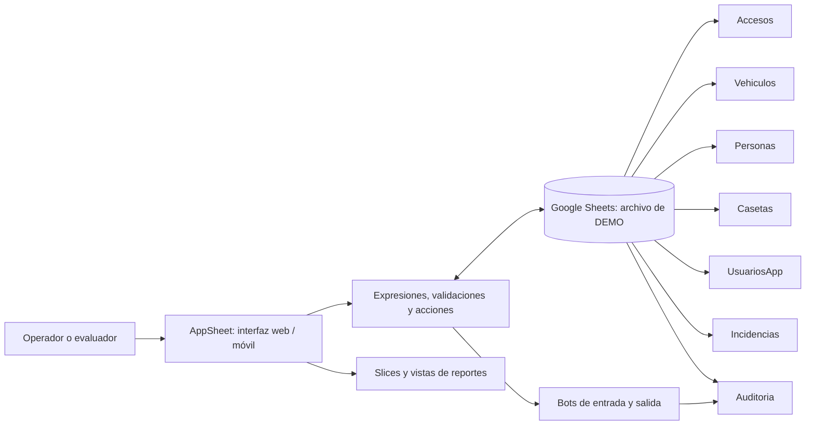

# Arquitectura y flujo operativo

**Fuente:** documentación exportada de AppSheet el 21-11-2026 a las 06:30; pruebas de la app realizadas durante el hackatón. Las afirmaciones sobre Bots se basan también en capturas/pruebas facilitadas por el equipo.

## Arquitectura lógica
- **Presentación:** vistas de AppSheet (table, deck, forms, dashboard y charts), adaptadas a escritorio/móvil.
- **Lógica:** expresiones AppSheet (`Valid If`, `Initial value`, `App formula`, `Only if`); acciones de modificación y automatizaciones Bots.
- **Persistencia:** pestañas de Google Sheets; ninguna base de datos SQL ni servicio web Apps Script creado para esta entrega.
- **Acceso:** autenticación con Google en la copia de evaluación; permisos amplios deliberados en esa copia (no adecuados para producción).
- **Trazabilidad:** tabla `Auditoria` con evento, fecha/hora, usuario, tabla, ID y detalle.

## Flujo de entrada
1. Cuenta autenticada abre `Control de Acceso` y el formulario nuevo.
2. Captura placa, tipo de usuario, datos del visitante y caseta.
3. Se comprueba que no haya estancia abierta con la misma placa; una fórmula consulta `Vehiculos` para clasificar autorización.
4. Al guardar: se genera `AccesoID`, `FechaHoraEntrada = NOW()`, `OperadorEntrada = USEREMAIL()`, `Estado = "Abierto"`.
5. El Bot de entrada pretende insertar un evento `CREAR_ENTRADA` en `Auditoria`; confirmar su ejecución en las pruebas.

## Flujo de salida
1. Abrir un acceso con `Estado = "Abierto"` y `FechaHoraSalida` vacía.
2. Acción **Registrar Salida** solicita caseta de salida.
3. Asignaciones: `Estado = "Cerrado"`, `FechaHoraSalida = NOW()`, `OperadorSalida = USEREMAIL()`, `CasetaSalidaID = [_INPUT].[CasetaSalida]`.
4. El Bot de salida pretende escribir `REGISTRAR_SALIDA` en `Auditoria`.

## Alcance
Tres casetas y tipos: Estudiante, Docente, Administrativo, Visitante. Consultas por placa, fecha, caseta y tipo; histogramas de entradas/salidas, placas frecuentes y horas; historial exportable como CSV.

## Limitaciones explícitas
AppSheet aloja la definición ejecutable en su plataforma. El repositorio presenta las expresiones/configuración verificables y el procedimiento de reproducción, pero no un ejecutable autónomo. La exportación técnica indica `Runnable? Yes` y `Deployable? No` a la hora de generarse; no confundir uso de prototipo con despliegue productivo aprobado.
