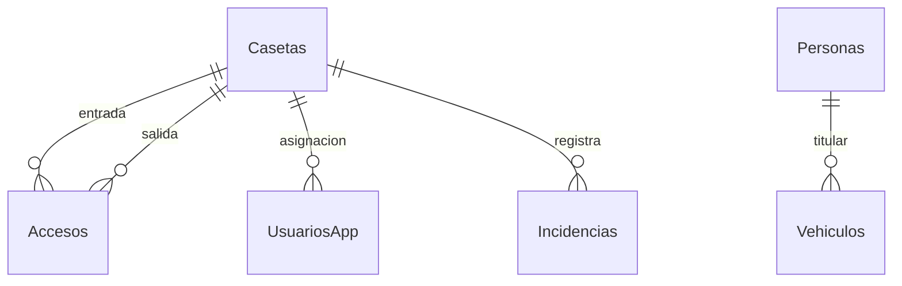

# Modelo de datos

Fuente: esquemas de la exportación de AppSheet `Documentacion_Tecnica_AppSheet.pdf` y su sección **Data → Tables / Columns**. Los siete catálogos funcionales se almacenan en pestañas de Google Sheets. La cifra **12 Tables** de la exportación incluye tabla de settings y cuatro tablas internas de estados/outputs de procesos; no son doce catálogos funcionales.

| Tabla | Llave | Campos principales y finalidad |
|---|---|---|
| Accesos | AccesoID | Placa, TipoUsuario, NombrePersona, Empresa, Identificacion, AreaVisita, Asunto, CasetaEntradaID, FechaHoraEntrada, OperadorEntrada, CasetaSalidaID, FechaHoraSalida, OperadorSalida, Estado, VehiculoID, PersonaID, Observaciones, ResultadoAutorizacion y auxiliares gráficos |
| Vehiculos | VehiculoID | Placa, PersonaID, Tarjeton, Autorizado, Observaciones |
| Personas | PersonaID | NombreCompleto, TipoUsuario, Identificador, campos de contacto y Activo |
| Casetas | CasetaID | NombreCaseta, Ubicacion, Activa |
| UsuariosApp | UsuarioID | Correo, Nombre, Rol, CasetaID, Activo |
| Incidencias | IncidenciaID | FechaHora, Placa, CasetaID, OperadorEmail, TipoIncidencia, Descripcion, Estado |
| Auditoria | AuditoriaID | FechaHora, UsuarioEmail, Accion, TablaAfectada, RegistroID, Detalle |

## Relaciones declaradas

Las columnas `CasetaEntradaID` y `CasetaSalidaID` son `Ref` a `Casetas[CasetaID]`; `Vehiculos[PersonaID]` es `Ref` a `Personas[PersonaID]`; `UsuariosApp[CasetaID]` e `Incidencias[CasetaID]` son referencias a `Casetas`. **Nota de precisión:** `Accesos[VehiculoID]` y `Accesos[PersonaID]` aparecen como **Text** en la exportación, no como `Ref`; no atribuir una relación foránea técnica que no esté configurada.

## Estados y reglas
- `Accesos[Estado]`: enum `Abierto`, `Cerrado`; inicia en `Abierto`.
- `Accesos[AccesoID]`: `UNIQUEID()`, llave.
- `Accesos[Placa]`: validación de duplicidad abierta.
- `Accesos[ResultadoAutorizacion]`: fórmula virtual, consulta catálogo.
- `Vehiculos[Autorizado]`: Yes/No, valor inicial `FALSE`.
- `UsuariosApp[Rol]`: Guardia, Supervisor, Administrador.

## Diccionario y reproducción
Véase `appsheet/expresiones.md`, `docs/reproduccion.md` y la exportación técnica original. Esta vista es un resumen, no representa una migración automática de la definición hospedada.
